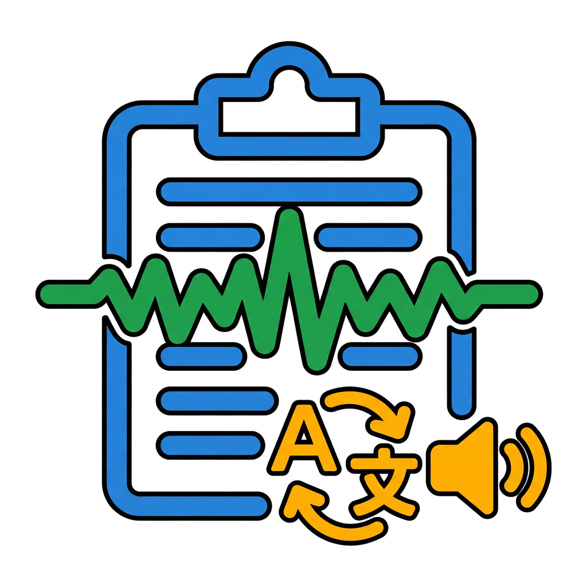

# ClipVoice



ClipVoice is a Windows app for clipboard history, reusable text templates, translation, and text-to-speech.

## Download

Download the standalone Windows x64 app from [GitHub Releases](https://github.com/merlinmedeo-ai/ClipVoice/releases/latest). No separate .NET installation is required.

### What's new in 1.1.0

- Online dictation with Groq Whisper large-v3 and automatic punctuation
- Personal API key encrypted with Windows DPAPI; setup instructions under ★
- Caps Lock to start / finish dictation, or a custom shortcut
- Automatic insertion into the original field, with the result retained on the clipboard
- Soft recording chime and a compact microphone level indicator

### What's new in 1.0.1

- Updated application icon and a dedicated system tray icon
- Translation results in a popup near the pointer
- Clipboard history available from the template popup menu
- Improved template popup behavior and clipboard duplicate detection

## Features

- Recent clipboard history
- Reusable text templates and global hotkeys
- Template menu with `Alt + Right-click`
- Translation of selected text or clipboard content
- Online speech through Edge with Google TTS as a fallback
- Optional offline Piper speech
- Local settings protected with Windows DPAPI
- System tray support and configurable hotkeys

## Requirements

- Windows 10 or Windows 11, x64
- .NET SDK 8 for development
- Internet access for online translation, online speech, and the initial Piper download

The self-contained release includes the .NET runtime and does not require a separate .NET installation.

## Run from source

```powershell
dotnet restore
dotnet run --project ClipVoice.csproj
```

If the .NET SDK is not installed globally, the project can download a local SDK into `.dotnet` (which Git ignores):

```powershell
.\run-debug.bat
```

## Build a standalone executable

Run:

```powershell
.\build-exe.bat
```

The executable is created at `dist\ClipVoice-1.1.0-win-x64\ClipVoice.exe`. The `dist` directory is excluded from Git; publish binary builds through GitHub Releases.

Equivalent command:

```powershell
dotnet publish ClipVoice.csproj `
  -c Release `
  -r win-x64 `
  --self-contained true `
  -p:PublishSingleFile=true `
  -p:IncludeNativeLibrariesForSelfExtract=true `
  -p:EnableCompressionInSingleFile=true
```

## Data and privacy

Settings, clipboard history, templates, logs, and the audio cache are stored in `%LocalAppData%\ClipVoice`, outside the repository. History and templates are protected with Windows DPAPI for the current user.

Text is sent to the relevant external services when you use online translation or speech. Piper works offline after its runtime and voice models have been downloaded. The app uses unofficial consumer interfaces for online services, so they may change without notice.

## Project structure

- `Views/` — WPF windows and layouts
- `Services/` — clipboard, Windows integration, translation, and speech
- `Models/` — settings and data models
- `Native/` — Win32 declarations
- `Assets/` — application icons
- `tools/` — local SDK setup scripts

## License

No license has been selected yet. Until a `LICENSE` file is added, standard copyright remains with the project owner. Publicly visible source code does not, by itself, grant permission to copy, modify, or distribute it.
# Диктовка через Groq

В настройках на вкладке **SPEECH & TRANSLATION** введите личный API-ключ Groq,
выберите язык и сохраните настройки. Кнопка **★** открывает инструкцию по получению
ключа на https://console.groq.com/keys. Ключ зашифрован Windows DPAPI и доступен
только текущему пользователю Windows; при переносе настроек его нужно ввести заново.

Установите курсор в текстовое поле и нажмите **Caps Lock**. После звукового сигнала
произнесите фразу и нажмите сочетание повторно. Через 60 секунд запись заканчивается
автоматически. Приложение отправляет WAV в Groq Whisper large-v3, вставляет результат
с пунктуацией в исходное поле и оставляет его в буфере и истории. Если вставка
недоступна, используйте Ctrl+V. Не меняйте поле назначения до завершения операции.

В настройках диктовки можно назначить Caps Lock или собственную комбинацию:
нажмите поле горячей клавиши, затем нужное сочетание и сохраните настройки.
Ранее сохранённое сочетание сохраняется; для перехода на Caps Lock назначьте его в этом поле.

Нужны интернет, микрофон по умолчанию и разрешение Windows на использование микрофона
классическими приложениями. Временный WAV удаляется после запроса. Бесплатный тариф
Groq имеет ограничения; дополнительные ключи одной организации не увеличивают квоту.
Управление хранением данных: https://console.groq.com/settings/data-controls.
Точность слов и пунктуации зависит от записи. При ошибке отправка автоматически
не повторяется. Полная проверка требует действующего ключа и записи с микрофона.
