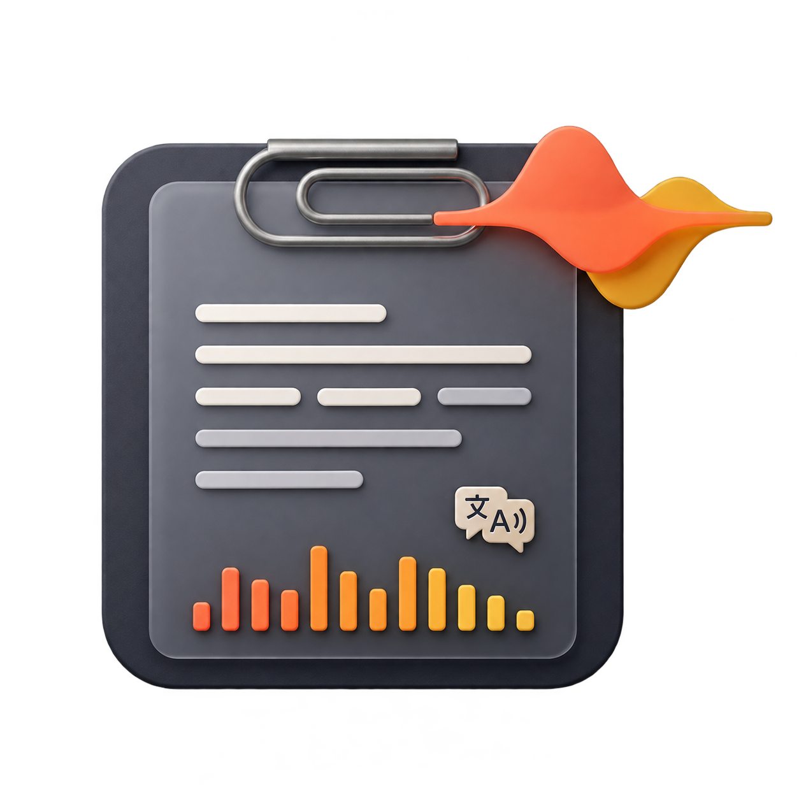

# ClipVoice 1.1.1

Диктовка, буфер обмена, шаблоны, перевод и озвучивание для Windows.

## Исправления 1.1.1

- На странице проекта и в релизе отображается актуальная иконка приложения.
- Обновлены описание функций, инструкции и сведения об обработке данных.
- Версия манифеста, EXE и сборочных файлов приведена к 1.1.1.

## Новое

- Диктовка через Groq Whisper large-v3 с автоматической пунктуацией.
- Личный API-ключ в настройках, защищённый Windows DPAPI.
- Инструкция получения ключа по кнопке ★.
- Caps Lock запускает запись, повторное нажатие отправляет фразу. Можно назначить своё сочетание.
- Текст вставляется в исходное поле и остаётся в буфере обмена и истории ClipVoice.
- Мягкий звуковой сигнал начала записи.
- Компактная панель с фиолетовыми полосками, реагирующими на громкость микрофона.
- Выбор русского, украинского, английского языка или автоматического определения.

## Установка

Скачайте `ClipVoice-1.1.1-win-x64.zip`, распакуйте и запустите `ClipVoice.exe`.
Закройте предыдущую версию перед запуском. Отдельная установка .NET не требуется.
Настройки и история сохраняются в профиле Windows.

Для диктовки откройте настройки → SPEECH & TRANSLATION, нажмите ★,
получите личный ключ Groq, вставьте его и сохраните настройки.
Ранее назначенная горячая клавиша сохраняется; при желании замените её на Caps Lock.

Нужны Windows 10/11 x64, интернет и доступ к микрофону.
Одна реплика ограничена 60 секундами. У бесплатного тарифа Groq есть собственные лимиты.
Запись отправляется в Groq; точность слов и пунктуации зависит от качества записи.
